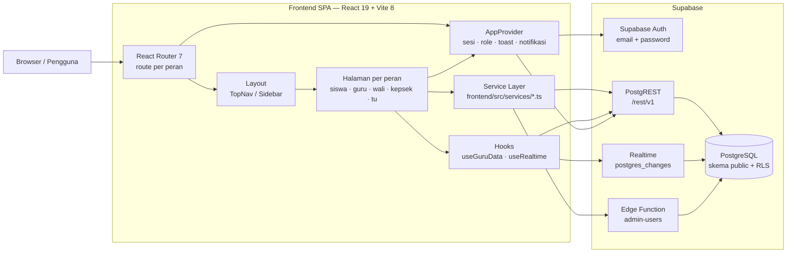
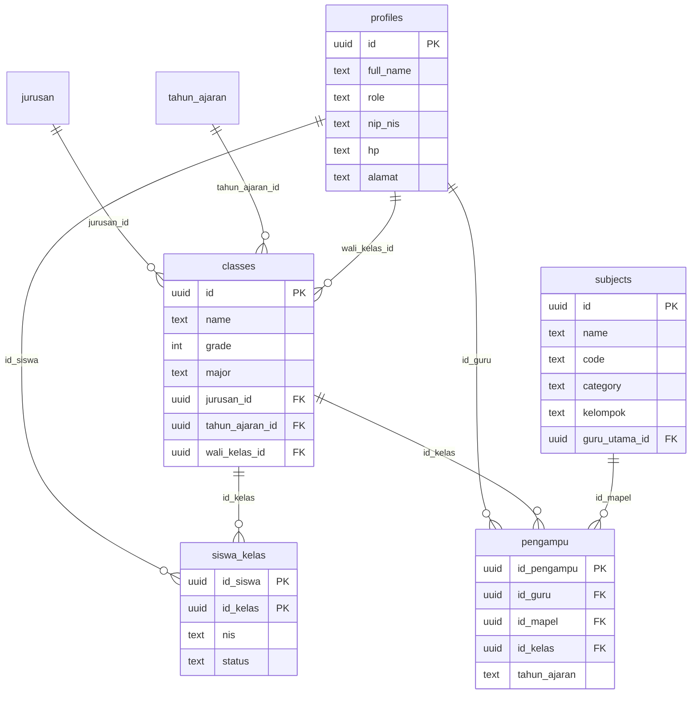
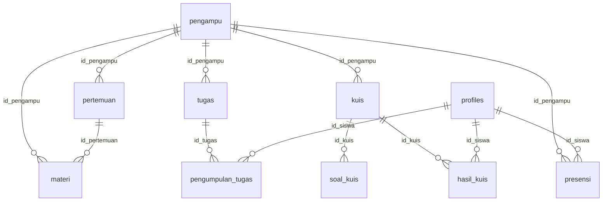

# Sistem Pembelajaran Digital SMK Negeri 2 Indramayu

Aplikasi LMS berbasis web untuk siswa, guru, wali kelas, kepala sekolah, dan tata usaha. Frontend berupa Single Page Application (SPA) React; autentikasi, database, dan sinkronisasi data memakai Supabase.

Dokumen ini menjelaskan arsitektur sistem, bukan panduan pemakaian fitur.

---

## 1. Ringkasan Arsitektur



Prinsip utamanya:

- **Satu aplikasi, lima peran.** Semua peran memakai bundel frontend yang sama; akses dibatasi oleh route guard dan RLS database.
- **Frontend tanpa backend perantara untuk operasi biasa.** Komponen memanggil Supabase langsung lewat `supabase-js` atau REST API.
- **Operasi istimewa lewat Edge Function.** Pembuatan pengguna, perubahan role/status, dan reset password dijalankan oleh `admin-users`, bukan dari browser dengan service-role key.
- **Service layer tipis.** Query Supabase dibungkus fungsi di `frontend/src/services` agar halaman tidak menulis query yang sama berulang.
- **Konteks global untuk sesi.** `AppProvider` menyimpan role, profil pengguna, toast, dialog konfirmasi, dan notifikasi.
- **Data contoh terpisah.** Tampilan yang belum terhubung database memakai data dari `frontend/src/mocks/index.ts`.

---

## 2. Teknologi

| Lapisan | Teknologi |
|---|---|
| UI | React 19, TypeScript 5.7 |
| Build | Vite 8, `@vitejs/plugin-react` |
| Styling | Tailwind CSS v4 via `@tailwindcss/vite` |
| Routing | React Router DOM 7 (`BrowserRouter`) |
| Ikon | `lucide-react` |
| Grafik | `recharts` |
| QR | `qrcode.react` |
| Backend | Supabase (Auth, PostgREST, Realtime, Edge Functions, PostgreSQL) |
| Format | `oxfmt` |
| Runtime | Node.js 22, pnpm 10 |

---

## 3. Struktur Folder

```text
.
├── frontend
│   ├── index.html                  # Shell Vite, elemen #root
│   ├── vite.config.ts              # React, Tailwind, alias @ -> frontend/src
│   ├── .env.example                # Contoh variabel Supabase
│   ├── public/                     # Aset statis
│   └── src
│       ├── main.tsx                # Entrypoint React
│       ├── App.tsx                 # Router, lazy loading, route per peran
│       ├── index.css               # Import Tailwind v4 + tema global
│       ├── components
│       │   ├── chatbot/            # EduBot
│       │   ├── layouts/            # RoleGate, TopNavLayout, SidebarLayout
│       │   ├── loaders/            # PageLoader, RouteLoader
│       │   └── ui/                 # Primitif UI bersama
│       ├── context/index.tsx       # AppProvider, useApp, useRole
│       ├── hooks
│       │   ├── useGuruData.ts      # Pengampu, tugas, kuis milik guru
│       │   └── useRealtime.ts      # Langganan perubahan tabel
│       ├── lib
│       │   ├── roles.ts            # Konfigurasi role dan menu
│       │   └── supabase.ts         # Klien Supabase dari environment
│       ├── mocks/index.ts          # Data contoh + helper tampilan
│       ├── pages
│       │   ├── auth/               # Login, lupa/ganti sandi, 404
│       │   ├── guru/               # Modul guru
│       │   ├── siswa/              # Modul siswa
│       │   ├── wali/               # Wali kelas dan kepala sekolah
│       │   ├── tu/                 # Tata usaha / master data
│       │   └── shared/             # Halaman lintas peran
│       ├── services                # Akses data ke Supabase
│       ├── types/database.types.ts # Tipe skema Supabase
│       └── utils/                  # Helper kecil
├── backend
│   ├── README.md
│   └── supabase
│       ├── config.toml
│       ├── migrations/             # Skema PostgreSQL, RLS, view, trigger
│       ├── functions/admin-users/  # Edge Function operasi istimewa
│       └── seed.sql
├── docs
│   └── plans/                      # Catatan rencana implementasi
├── .figma/make/site.json           # Konfigurasi plugin Figma Make
└── README.md
```

`frontend/src/utils` dipertahankan karena masih dipakai kode yang ada, tetapi tidak termasuk struktur target awal.

---

## 4. Lapisan Frontend

### 4.1 Entrypoint dan bootstrap

1. `frontend/index.html` memuat `frontend/src/main.tsx`.
2. `main.tsx` memasang `App.tsx` ke `#root` dalam `React.StrictMode`.
3. `App.tsx` membungkus aplikasi dengan `BrowserRouter` dan `AppProvider`.
4. Semua halaman per peran dimuat malas (`React.lazy`) dan ditampilkan di balik `Suspense` dengan `PageLoader`.

### 4.2 Routing dan kontrol akses

Setiap peran memiliki prefiks route sendiri:

| Peran | Prefiks | Halaman awal | Layout |
|---|---|---|---|
| Siswa | `/siswa` | `/siswa/beranda` | `TopNavLayout` |
| Guru | `/guru` | `/guru/beranda` | `TopNavLayout` |
| Wali Kelas | `/wali` | `/wali/beranda` | `TopNavLayout` |
| Kepala Sekolah | `/kepsek` | `/kepsek/beranda` | `TopNavLayout` |
| Tata Usaha | `/tu` | `/tu/dashboard` | `SidebarLayout` |

`RoleGate` memeriksa `role` dari `AppProvider`. Jika role tidak cocok, pengguna dialihkan ke beranda perannya sendiri; jika belum login, dialihkan ke `/login`.

Route publik:

- `/login`
- `/lupa-sandi`
- `/ganti-sandi`

Route siswa yang membutuhkan layar penuh (`/siswa/kuis/:id/kerjakan`) diletakkan di luar `TopNavLayout` agar tanpa navigasi.

Pembatasan ini hanya lapisan UI. Otorisasi sebenarnya tetap bergantung pada kebijakan RLS di PostgreSQL.

### 4.3 Layout

- `TopNavLayout` — header gelap, menu horizontal, notifikasi, menu akun, kalender, chatbot. Dipakai siswa, guru, wali, dan kepala sekolah.
- `SidebarLayout` — sidebar bergrup untuk master data, akademik, pengguna, dan sistem. Dipakai tata usaha.
- `components/loaders` menangani loader awal dan transisi route.
- `components/chatbot` (EduBot) tampil di kedua layout. Chatbot mencari daftar mata pelajaran dan kelas dari tabel `mapel`/`kelas` lalu memberi jawaban berbasis aturan.

### 4.4 State global

`frontend/src/context/index.tsx` menyediakan:

- `role`, `userData`, `login()`, `logout()`, `refreshUser()`.
- `toast()`, dialog `confirm()`.
- Daftar notifikasi contoh dan penandaan sudah dibaca.

Sesi dipulihkan dari `localStorage` (`spd-role`, `spd-user`) dan diverifikasi ulang ke Supabase Auth saat aplikasi dimuat. `onAuthStateChange` menangani login baru, lalu mengambil profil dari tabel `profiles`.

### 4.5 Halaman

| Folder | Tanggung jawab |
|---|---|
| `pages/auth` | Login, lupa sandi, ganti sandi, 404 |
| `pages/siswa` | Beranda, kelas, materi, tugas, kuis, nilai, kehadiran |
| `pages/guru` | Beranda guru, kelas, materi, tugas, kuis, presensi, penilaian, bank soal, rekap, media |
| `pages/wali` | Beranda wali, kelas perwalian, detail siswa, rekap nilai/kehadiran |
| `pages/wali/kepsek-*` | Beranda, statistik, keaktifan guru, laporan kepala sekolah |
| `pages/tu` | Dashboard, master data, jadwal, penugasan guru, tahun ajaran, pengguna, log |
| `pages/shared` | Akun, pengumuman, jadwal, notifikasi, panduan, pengaturan |

Barrel `index.ts` pada setiap folder mempertahankan nama ekspor yang dipakai `App.tsx`.

Banyak halaman menggabungkan dua sumber data:

- **Data dummy** dari `frontend/src/mocks/index.ts` untuk tampilan yang belum dimigrasi.
- **Data Supabase** lewat service atau query langsung untuk modul yang sudah terhubung.

### 4.6 Komponen UI bersama

`components/ui/index.tsx` menyediakan primitif visual: `Card`, `DataTable`, `Modal`, `Drawer`, `Field`, `Input`, `Select`, `Tabs`, `Badge`, `Stat`, `Progress`, `Avatar`, `PageHeader`, dan helper seperti `download`, `cn`, `useCrumbs`. Tidak ada design system eksternal selain Tailwind.

---

## 5. Lapisan Akses Data

### 5.1 Service layer

Service membungkus operasi Supabase dan melempar `error` agar dapat ditangkap halaman.

| Modul | Tabel / view utama | Operasi |
|---|---|---|
| `akademik.ts` | `profiles`, `classes`, `subjects`, `pengampu`, `siswa_kelas`, `jurusan`, `activity_log` | Baca, tambah, ubah, hapus master data; statistik; mapping ke bentuk `Offering` |
| `materi.ts` | `pertemuan`, `materi`, `tugas`, `pengumpulan_tugas`, `kuis`, `soal_kuis`, `hasil_kuis` | CRUD materi, tugas, kuis, pengumpulan, penilaian |
| `presensi.ts` | `presensi`, `v_rekap_kehadiran`, `v_rekap_nilai`, `notifikasi`, `activity_log`, `pengaturan`, `tahun_ajaran` | Presensi, rekap, notifikasi, log, pengaturan |
| `pengumuman.ts` | `pengumuman` | CRUD pengumuman dengan filter role |
| `profil.ts` | `profiles` | Baca profil, ubah field yang diizinkan |
| `siswa.ts` | `siswa_kelas`, `classes`, `pengampu`, `subjects`, `tugas`, `pengumpulan_tugas`, `presensi` | Query kelas, tugas, dan presensi siswa |
| `admin.ts` | Edge Function `admin-users` | Buat pengguna, ubah role/status, reset password |

Pola umum fungsi: `fetch*`, `create*`, `update*`, `delete*`, dengan tipe TypeScript di file yang sama.

`frontend/src/types/database.types.ts` menyimpan tipe `Database` hasil pembangkitan skema Supabase. File ini dapat diperbarui dengan perintah pada bagian 9.3.

### 5.2 Query langsung dari komponen

Beberapa modul belum sepenuhnya lewat service:

- `pages/siswa/beranda.tsx` memakai query langsung dan langganan realtime untuk pengumuman.
- `components/chatbot` memakai `supabase.from('mapel')` dan `supabase.from('kelas')`.
- `context/index.tsx` membaca `profiles` saat sesi berubah.

Query langsung ini membuat lapisan akses data belum seragam. Migrasi berikutnya sebaiknya memindahkannya ke service.

### 5.3 Realtime

`frontend/src/hooks/useRealtime.ts` menyediakan langganan generik `postgres_changes` untuk satu tabel dengan filter opsional. Callback disimpan di ref agar perubahan render tidak memicu langganan ulang; channel dibersihkan saat unmount.

Halaman pengumuman dan beranda siswa masih memasang channel langsung. Setiap komponen pemasang channel wajib membersihkan channel saat unmount.

---

## 6. Autentikasi dan Otorisasi

### 6.1 Alur login

1. Pengguna mengisi email dan password di `/login`.
2. `pages/auth/login.tsx` memanggil `supabase.auth.signInWithPassword()`.
3. Setelah sesi diterima, aplikasi mengambil role pengguna dari tabel `profiles`.
4. Role dipetakan ke salah satu nilai UI: `siswa`, `guru`, `wali`, `kepsek`, `tu`.
5. `login()` menyimpan role dan profil ke `localStorage`, lalu mengarahkan ke beranda sesuai peran.
6. Saat aplikasi dibuka lagi, `AppProvider` memanggil `supabase.auth.getSession()` dan menyegarkan profil.

### 6.2 Perbedaan nilai role

Ada dua kamus role yang perlu diselaraskan:

- **UI / route:** `siswa`, `guru`, `wali`, `kepsek`, `tu`.
- **Constraint database:** `super_admin`, `kepala_sekolah`, `guru`, `siswa`, `wali_kelas`.

`pages/auth/login.tsx` memetakan label lama seperti `Tata Usaha`, `Guru Mapel`, `Wali Kelas`, dan `Kepala Sekolah`. Jika nilai di database tidak cocok dengan pemetaan ini, pengguna akan jatuh ke role `siswa`.

Rekomendasi: simpan satu enum role yang baku di database dan gunakan pemetaan eksplisit di `frontend/src/lib/roles.ts`.

### 6.3 Otorisasi database (RLS)

Migrasi mengaktifkan Row Level Security pada tabel utama. Ringkasannya:

- `profiles`: dapat dibaca publik; pengguna dapat mengubah profil sendiri; `super_admin` dapat mengelola semua.
- Master akademik (`classes`, `subjects`, `pengampu`, `pertemuan`, `materi`, `tugas`, `kuis`, `soal_kuis`): umumnya **select publik**, **tulis untuk pengguna terautentikasi**.
- `pengumpulan_tugas` dan `hasil_kuis`: siswa hanya boleh menyisipkan data miliknya; guru dapat menilai.
- `presensi`: dapat dibaca publik; guru pengampu dapat menulis.
- `jurusan`, `tahun_ajaran`, `siswa`, `guru`, `jadwal_pelajaran`: dikelola `super_admin`, dapat dibaca pengguna terautentikasi.
- `pengumuman`, `notifikasi`, `pengaturan`, `activity_log`: belum memiliki kebijakan RLS yang ketat di migrasi; perlu ditinjau.

Kebijakan select publik pada data akademik longgar. Untuk produksi, sebaiknya dibatasi pada pengguna terautentikasi dan, bila perlu, pada kelas atau pengampu yang terkait.

### 6.4 Operasi istimewa

`backend/supabase/functions/admin-users/index.ts` memverifikasi sesi pemanggil, memeriksa role `super_admin`/`tata_usaha`/`tu`, lalu memakai service-role key di server untuk:

- membuat pengguna Auth,
- mengubah role profil,
- mengubah status profil,
- mereset kata sandi.

Frontend hanya memanggil fungsi ini lewat `frontend/src/services/admin.ts`.

---

## 7. Model Data

### 7.1 Identitas dan master akademik



### 7.2 Pembelajaran dan penilaian



Tabel pendukung:

- `pengumuman` — pengumuman dengan target role dan/atau kelas.
- `notifikasi` — notifikasi per pengguna.
- `activity_log` — jejak aktivitas pengguna.
- `pengaturan` — konfigurasi sistem berbentuk key/value JSONB.
- `tahun_ajaran` — daftar tahun ajaran dan status aktif.
- `chat_messages` — riwayat pesan chatbot.
- `presensi_sesi` — rencana sesi presensi.

View database:

- `v_rekap_kehadiran` — agregasi hadir, izin, sakit, alpa, dan persentase per siswa per pengampu.
- `v_rekap_nilai` — rata-rata tugas, rata-rata kuis, dan nilai sementara per siswa per pengampu.

Fungsi database:

- `get_my_role()` — helper RLS untuk membaca role pengguna aktif.
- `is_admin()` — helper RLS lama.
- `handle_updated_at()` — trigger pembaruan timestamp.
- `get_siswa_per_jurusan()` — dipanggil dari frontend dengan fallback query manual bila belum tersedia.

### 7.3 Tabel warisan

Migrasi awal membuat `projects`, `skills`, `messages`, dan `message_replies` untuk keperluan portofolio/kontak. Tabel ini tidak dipakai oleh alur LMS dan dapat diarsipkan bila tidak diperlukan.

---

## 8. Alur Data Utama

### 8.1 Guru mengelola kelas

1. Guru membuka `/guru/kelas`.
2. `useGuruData` mengambil daftar `pengampu` milik guru dari `profiles.id`.
3. Hasil dipetakan menjadi `Offering` untuk kebutuhan tampilan.
4. Sebagian halaman detail masih memakai data contoh, sementara presensi, tugas, kuis, dan pengampu sudah memiliki jalur service ke Supabase.
5. Perubahan pada modul yang sudah terhubung ditulis melalui `services/materi.ts` atau `services/presensi.ts`.

### 8.2 Siswa mengerjakan kuis

1. Siswa membuka `/siswa/kuis/:id`.
2. Halaman mengambil kuis dan soal dari data contoh `frontend/src/mocks/index.ts` (`kuisById`, `kuisSoalOf`).
3. Jawaban disimpan sementara di `sessionStorage` selama pengerjaan.
4. Skor dihitung di sisi klien dari kunci jawaban pada data contoh.
5. Halaman hasil membaca kembali `sessionStorage`.

Service `submitKuis` dan tabel `hasil_kuis` sudah tersedia, tetapi alur kuis siswa belum menulis hasil ke database. Integrasi ini masih utang teknis. Karena kunci jawaban berada di data klien, mekanisme penilaian perlu dipindahkan ke server sebelum dipakai untuk penilaian resmi.

### 8.3 Tata usaha mengelola master data

1. `/tu/*` memakai `SidebarLayout`.
2. Komponen `Crud` generik menampilkan tabel, form, filter, impor, dan ekspor.
3. Operasi simpan/hapus memanggil service `akademik.ts`.
4. Statistik dashboard memakai `fetchStats` dan `fetchSiswaPerJurusan`.
5. Operasi pengguna memanggil Edge Function `admin-users` lewat `services/admin.ts`.

### 8.4 Pengumuman dan notifikasi

1. Pengumuman disimpan di tabel `pengumuman` dengan target role atau kelas.
2. Halaman siswa, guru, dan pengumuman bersama memuat data melalui `services/pengumuman.ts`.
3. `pages/siswa/beranda.tsx` berlangganan perubahan tabel `pengumuman` untuk memperbarui daftar secara realtime.
4. Notifikasi di header saat ini berasal dari data contoh di `frontend/src/mocks/index.ts`, bukan dari tabel `notifikasi`.

---

## 9. Konfigurasi dan Menjalankan Aplikasi

### 9.1 Prasyarat

- Node.js 22
- pnpm 10
- Supabase CLI untuk pengelolaan database

### 9.2 Perintah frontend

Jalankan dari folder `frontend`:

```bash
pnpm install
pnpm dev       # server pengembangan Vite, port default 8443
pnpm build     # build produksi
pnpm preview   # pratinjau hasil build
pnpm format    # format dengan oxfmt
pnpm exec tsc --noEmit
```

### 9.3 Konfigurasi Supabase

Buat `frontend/.env` dari contoh:

```env
VITE_SUPABASE_URL=https://<project-ref>.supabase.co
VITE_SUPABASE_ANON_KEY=<anon-key>
```

Hanya anon key yang boleh berada di frontend. Jangan pernah menaruh service-role key di variabel `VITE_*` atau kode browser.

`frontend/src/lib/supabase.ts` membuat satu klien dari variabel tersebut dan melempar error bila salah satu kosong.

Untuk memperbarui tipe database dari project remote:

```bash
supabase --workdir backend gen types typescript --linked > frontend/src/types/database.types.ts
```

Migrasi database dikelola lewat Supabase CLI. Lihat `backend/README.md` untuk perintah `link`, `db push`, dan deploy Edge Function.

---

## 10. Peringatan Keamanan

- **Rotasi service-role key.** Key tersebut pernah tercatat di riwayat Git. Menghapusnya dari kode saat ini tidak membatalkan kebocorannya; rotasi di dashboard Supabase tetap wajib.
- **Jangan menaruh service-role key di frontend.** Operasi istimewa harus lewat Edge Function `admin-users` yang menyimpan key di environment server.
- **Anon key bukan rahasia**, tetapi tetap dikelola lewat environment agar mudah diganti.
- **Kunci jawaban kuis dapat dibaca klien.** Penilaian resmi perlu dipindahkan ke server.
- **Beberapa kebijakan RLS terlalu longgar.** Select publik dan write untuk semua pengguna terautentikasi perlu ditinjau.
- **Validasi peran belum konsisten.** Nilai role UI dan constraint database harus diselaraskan.
- **`localStorage` hanya cache tampilan.** Jangan menganggapnya sebagai bukti otorisasi.
- **Chatbot mengakses tabel `mapel`/`kelas`** yang tidak ada di migrasi; query akan gagal sampai nama tabel diselaraskan.

---

## 11. Catatan Teknis dan Utang Teknis

- **Dua sumber data.** Sebagian besar tampilan memakai data dummy; sebagian modul sudah memakai Supabase.
- **Service belum konsisten.** Query langsung di halaman dan chatbot sebaiknya dipindah ke service.
- **Role ganda.** Satukan nilai role database dan UI.
- **Notifikasi masih dummy.** Tabel `notifikasi` dan service-nya sudah ada, tetapi header belum memakainya.
- **Realtime belum terpusat.** Ada hook generik, tetapi implementasi masih tersebar di halaman.
- **Media library belum memakai Storage.** Komponen media memakai data contoh; integrasi Supabase Storage belum terlihat.
- **Edge Function belum tentu ter-deploy.** `admin-users` harus di-deploy dengan `SUPABASE_SERVICE_ROLE_KEY` sebelum fitur pengguna TU berfungsi.
- **Pengaturan Figma Make.** `frontend/vite.config.ts` memuat plugin khusus Figma Make dan membaca `../.figma/make/site.json`.
- **Tidak ada test.** Belum ada unit test atau integration test di repositori.

---

## 12. Ringkasan Alur Request

```text
Pengguna
  → React Router memilih halaman berdasarkan prefiks peran
  → RoleGate memeriksa role dari AppProvider
  → Layout menampilkan navigasi dan chatbot
  → Halaman memanggil service atau hook
  → Service memanggil supabase-js
  → Supabase Auth memvalidasi sesi
  → PostgREST menjalankan query dengan RLS
  → PostgreSQL mengembalikan data
  → Halaman merender hasil; realtime memperbarui data tanpa refresh
```

Dokumen ini mengikuti kondisi kode saat ini. Perbarui bila ada perubahan pada skema database, pembagian peran, atau lapisan akses data.
